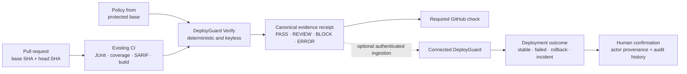

# DeployGuard AI

**Prove what was checked before a change ships—and record what happened next—without sending source code to an LLM.**

[](https://github.com/kingggg5/deployguardai/actions/workflows/ci.yml)
[](https://github.com/kingggg5/deployguardai/actions/workflows/codeql.yml)
[](https://securityscorecards.dev/viewer/?uri=github.com/kingggg5/deployguardai)
[](https://github.com/kingggg5/deployguardai/releases)
[](LICENSE)

> **Status:** self-hosted alpha. DeployGuard Verify is released as `v0.1.0`.
> Connected deployments still require operator-managed infrastructure and credentials.

[ภาษาไทย](README_TH.md) · [Quickstart](docs/QUICKSTART.md) · [Architecture](docs/ARCHITECTURE.md) · [Roadmap](docs/ROADMAP.md) · [Security](docs/SECURITY.md)


DeployGuard is an open-source change-safety and production-evaluation platform
for GitHub, platform engineering, DevOps, and SRE teams. It converts the
artifacts your CI already produces into a canonical receipt bound to the exact
base and head commits. Connected mode can then associate that revision with a
deployment, incident, rollback, stability window, and accountable human verdict.

## Why DeployGuard

| Problem | DeployGuard response |
| --- | --- |
| Green CI does not show what was actually checked | Canonical receipt with evidence IDs, hashes, source SHA, freshness, and unknown lanes |
| Pull-request metadata is not verification | PASS, REVIEW, BLOCK, and ERROR come from parsed artifacts and protected-base policy |
| Deployment and incident history live in separate tools | Exact-SHA outcome records connect change, deployment, incident, rollback, and human confirmation |
| Operational data is difficult to reuse safely | Consent, redaction, immutable release records, revocation tombstones, and leakage checks |
| Agent prose can sound more certain than the evidence | The CLI is authoritative; Skills can orchestrate it but cannot change its decision |

DeployGuard does **not** upload source code to an LLM, execute repository
commands, merge pull requests, deploy, roll back, or modify infrastructure.

## Verify a pull request

Use the composite Action after your build and test steps. Start with the release
tag, then replace it with the tag's full commit SHA before protecting the check.

```yaml
name: DeployGuard Verify
on: pull_request

permissions:
  contents: read

jobs:
  evidence:
    runs-on: ubuntu-latest
    steps:
      - uses: actions/checkout@3d3c42e5aac5ba805825da76410c181273ba90b1 # v7
        with:
          ref: ${{ github.event.pull_request.head.sha }}
          fetch-depth: 0
          persist-credentials: false

      # Run your build, tests, coverage, and security tools here.

      - uses: kingggg5/deployguardai@v0.1.0
        with:
          base-sha: ${{ github.event.pull_request.base.sha }}
          head-sha: ${{ github.event.pull_request.head.sha }}
          evidence-sha: ${{ github.event.pull_request.head.sha }}
          build-status: success
          junit: artifacts/junit.xml
          coverage: artifacts/coverage.xml
          sarif: artifacts/results.sarif
```

Resolve the immutable release pin with:

```bash
git ls-remote https://github.com/kingggg5/deployguardai.git 'refs/tags/v0.1.0^{}'
```

The Action writes `.deployguard/artifacts/evidence-receipt.json`. Missing,
stale, or SHA-mismatched evidence stays REVIEW; it never becomes PASS by
inference.

| Decision | Exit | Meaning |
| --- | ---: | --- |
| PASS | 0 | Required evidence is present, exact-SHA matched, and compliant. |
| REVIEW | 2 | Evidence is missing, stale, mismatched, or needs a human decision. |
| BLOCK | 3 | Observed evidence violates an objective policy rule. |
| ERROR | 4 | Verification could not complete; the gate failed closed. |

## Use it as a Codex plugin

DeployGuard ships one focused Agent Skill. It helps an agent collect the
authorized artifacts, invoke the verifier, and cite the resulting receipt. It
cannot manufacture evidence, weaken protected-base policy, or override a gate.

```bash
codex plugin marketplace add kingggg5/deployguardai --ref main
```

Restart Codex, open **Plugins**, and install **DeployGuard AI**. Then ask:

```text
Use $deployguard-change-safety to verify this pull request and cite its evidence receipt.
```

`main` is the preview channel. Pin a reviewed release tag when the plugin is
included in the next tagged release.

The plugin is an interaction layer; install the deterministic verifier in the
repository where it will run:

```bash
git clone https://github.com/kingggg5/deployguardai.git
cd deployguardai
python -m pip install ./verify
deployguard init --github --agent codex
```

No LLM provider key is required. The host agent may use its existing account,
but model output is never accepted as verification evidence.

## How it works



The trusted path is deterministic. Risk scoring and agent explanations remain
advisory and cannot replace the receipt.

## Run the connected platform

```bash
git clone https://github.com/kingggg5/deployguardai.git
cd deployguardai
cp .env.example .env
docker compose up --build
```

- Web: <http://127.0.0.1:4300>
- Public control plane and OpenAPI: <http://127.0.0.1:8100/docs>
- Demo data: use the isolated, visibly labelled profile in the [Quickstart](docs/QUICKSTART.md)

Connected mode starts empty. The ASP.NET Core 10/YARP control plane is the
public boundary; FastAPI and the worker remain private. PostgreSQL 16 is the
production source of truth with tenant RLS. Angular provides the web client,
and Python owns the deterministic evidence and evaluation engines.

## Project truth

- **Implemented:** deterministic receipts, authenticated receipt ingestion,
  evidence-backed GitHub Checks, explicit deployment outcomes, OTLP-normalized
  intake, notification outbox jobs, SLO summaries, PostgreSQL RLS, and governed
  dataset release/revocation records.
- **Operator configured:** GitHub App credentials, production attestation keys,
  OIDC, non-owner PostgreSQL roles, the OTLP Collector, and Slack/Teams/PagerDuty
  destinations.
- **Dataset status:** schemas and governance exist, but the public repository
  contains synthetic examples only. DeployGuard Bench is not a production
  benchmark until a consented real corpus, reviewed redaction, adjudicated
  annotations, frozen splits, contamination checks, and baseline evaluations exist.

## Documentation

- [Quickstart](docs/QUICKSTART.md) · [Architecture](docs/ARCHITECTURE.md) · [Operations](docs/OPERATIONS.md)
- [Security model](docs/SECURITY.md) · [API contract](docs/API_CONTRACT.md) · [AI boundary](docs/AI_BOUNDARY.md)
- [DeployGuard Bench dataset card](bench/README.md) · [Roadmap](docs/ROADMAP.md)

## Community

[Contributing](CONTRIBUTING.md) · [Code of Conduct](CODE_OF_CONDUCT.md) ·
[Governance](GOVERNANCE.md) · [Support](SUPPORT.md) ·
[Security reporting](.github/SECURITY.md) · [Changelog](CHANGELOG.md)

DeployGuard AI is licensed under [Apache-2.0](LICENSE).
