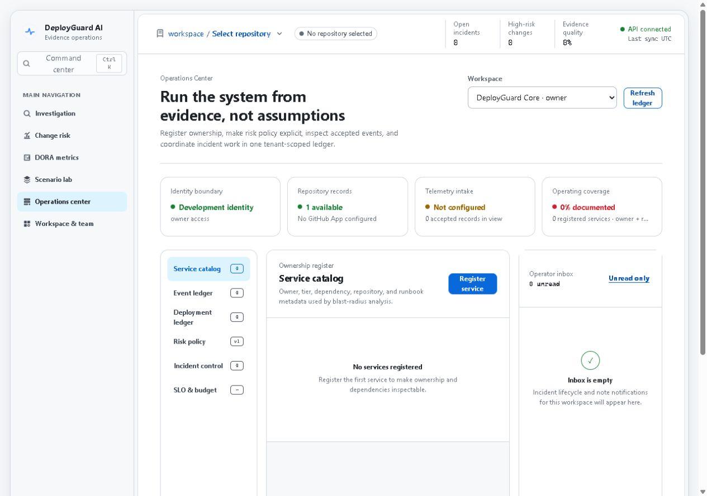

# DeployGuard AI

**Evidence you can verify before merge, and outcomes you can account for after deploy — without an LLM key.**

> **Status:** pre-release / self-hosted alpha. The connected runtime is ready
> for controlled evaluation; the public dataset remains synthetic.

[ภาษาไทย](README_TH.md) · [Quickstart](docs/QUICKSTART.md) · [Architecture at a glance](docs/ARCHITECTURE.md#architecture-at-a-glance) · [Roadmap](docs/ROADMAP.md)

_The current Operations surface is shown with an explicitly labelled local
development identity. It is a product walkthrough, not production evidence._

DeployGuard is an open-source change-safety and production-evaluation platform
for GitHub, DevOps, and SRE teams. It turns the artifacts your CI already
produces into a canonical, SHA-bound evidence receipt, then keeps deployment,
incident, verification, and human decision history auditable in one workspace.

DeployGuard never uploads source code to an LLM, runs repository commands,
deploys, rolls back, or changes infrastructure. The deterministic verifier is
the authority; optional agent instructions only make that verifier easier to
use.

## What it does

- **DeployGuard Verify** — a keyless CLI and composite GitHub Action that reads
  JUnit, Cobertura/LCOV, SARIF, and build results; binds them to exact base/head
  commits; and returns stable PASS, REVIEW, BLOCK, or ERROR decisions.
- **Evidence-first operations** — risk and blast-radius analysis, evidence and
  counter-evidence, deployment matching, incident lifecycle, SLO/error-budget
  signals, and accountable human verdicts.
- **Governed operational memory** — immutable postmortem snapshots, audited
  consent, conservative secret/PII redaction, leakage checks, and an append-only
  dataset release registry with revocation tombstones.

## Verify a change in five minutes

The Action is released from this repository. Use the convenience tag while
testing, then pin the tag's full commit SHA in a protected production workflow:

~~~yaml
name: DeployGuard Verify
on: pull_request
permissions:
  contents: read
  checks: write

jobs:
  evidence:
    runs-on: ubuntu-latest
    steps:
      - uses: actions/checkout@3d3c42e5aac5ba805825da76410c181273ba90b1 # v7
        with:
          fetch-depth: 0
      - uses: kingggg5/deployguardai@v0.1.0 # convenience tag; pin its resolved commit SHA in production
        with:
          base-sha: ${{ github.event.pull_request.base.sha }}
          head-sha: ${{ github.event.pull_request.head.sha }}
          junit: artifacts/junit.xml
          coverage: artifacts/coverage.xml
          sarif: artifacts/results.sarif
~~~

Resolve the immutable pin from the release tag before enabling branch
protection:

~~~bash
git ls-remote https://github.com/kingggg5/deployguardai.git refs/tags/v0.1.0
~~~

The receipt is written to .deployguard/artifacts/evidence-receipt.json and
can optionally be published to a connected workspace with an HMAC secret. The
connected ingress verifies the signature, canonical receipt hash, repository,
exact head SHA, and detached attestation before the GitHub Check can use it.
Missing or unverified evidence stays REVIEW; it never becomes a green check
by inference.

| Decision | Exit | Meaning |
| --- | ---: | --- |
| PASS | 0 | Required artifacts are present, fresh, SHA-matched, and compliant. |
| REVIEW | 2 | Evidence is missing, stale, mismatched, or needs a human decision. |
| BLOCK | 3 | Observed evidence violates an objective policy rule. |
| ERROR | 4 | Verification failed and the gate closed safely. |

Install the local verifier from a checkout:

~~~bash
git clone https://github.com/kingggg5/deployguardai.git
cd deployguardai
python -m pip install ./verify
deployguard init --github --agent codex
~~~

## Connected platform

~~~bash
git clone https://github.com/kingggg5/deployguardai.git
cd deployguardai
cp .env.example .env
docker compose up --build
~~~

Open <http://127.0.0.1:4300>. The public API is exposed through the ASP.NET
Core 10/YARP control plane at <http://127.0.0.1:8100/docs>; the FastAPI
application and worker stay on the private service network. Connected mode
starts empty. For a labelled isolated walkthrough, use the demo Compose
profile in the [Quickstart](docs/QUICKSTART.md).

The Operations surface keeps ownership, events, deployments, policy, SLO
signals, and incident response in separate, calm work areas.

## Current truth

- Implemented: deterministic Verify receipts, authenticated receipt ingestion,
  evidence-backed GitHub Check decisions, explicit deployment outcome states,
  OTLP-normalized intake, allow-listed Slack/Teams/PagerDuty outbox jobs, SLO
  summaries, PostgreSQL RLS, and governed release/revocation records.
- Environment-gated: real GitHub App credentials, attestation production keys,
  OIDC, PostgreSQL non-owner runtime roles, OTLP Collector, and notification
  destinations must be configured by the operator.
- Dataset status: the schema and governance path are ready for development,
  but the repository contains only synthetic examples. It is **not** a public
  production benchmark until a consented real corpus, reviewed redaction,
  annotation/adjudication, frozen splits, contamination checks, and baseline
  evaluation exist.

## Architecture

Angular provides the web client. ASP.NET Core 10 and YARP are the public,
fail-closed control plane. FastAPI owns the internal application contracts, and
Python owns deterministic risk/evidence engines. PostgreSQL 16 is the production
source of truth with tenant RLS; SQLite is for local development. Alembic is the
single migration authority during the coexistence period.

See [Architecture](docs/ARCHITECTURE.md), [Operations](docs/OPERATIONS.md),
[Security](docs/SECURITY.md), and the [DeployGuard Bench dataset card](bench/README.md).

## Community and licensing

- [Contributing](CONTRIBUTING.md) · [Code of Conduct](CODE_OF_CONDUCT.md) · [Governance](GOVERNANCE.md)
- [Security reporting](.github/SECURITY.md) · [Support](SUPPORT.md) · [Changelog](CHANGELOG.md)
- [API contract](docs/API_CONTRACT.md) · [AI boundary](docs/AI_BOUNDARY.md)

DeployGuard AI is licensed under [Apache-2.0](LICENSE).
