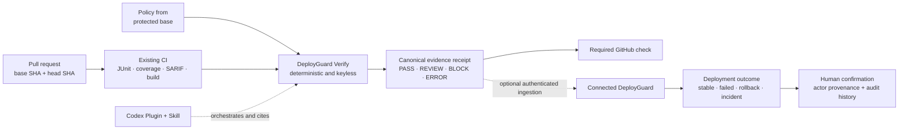

# DeployGuard AI

**Prove what was checked before a change ships—and record what happened after—without sending source code to an LLM.**

[](https://github.com/kingggg5/deployguardai/actions/workflows/ci.yml)
[](https://github.com/kingggg5/deployguardai/actions/workflows/codeql.yml)
[](https://securityscorecards.dev/viewer/?uri=github.com/kingggg5/deployguardai)
[](https://github.com/marketplace/actions/deployguard-verify)
[](LICENSE)

[ภาษาไทย](README_TH.md) · [Quickstart](docs/QUICKSTART.md) · [Architecture](docs/ARCHITECTURE.md) · [Roadmap](docs/ROADMAP.md) · [Security](docs/SECURITY.md)


DeployGuard AI is an open-source change-safety platform for GitHub, platform
engineering, DevOps, and SRE teams. It converts artifacts your CI already
produces into a canonical receipt bound to the exact base and head commits.
Connected mode then links that revision to deployment outcomes, incidents,
rollbacks, stability windows, and accountable human decisions.

No LLM key is required for verification. Agent Skills improve the workflow;
the deterministic receipt—not agent prose—owns the decision.

## Why teams use it

| Problem | DeployGuard response |
| --- | --- |
| Green CI does not explain what was checked | One content-addressed receipt records evidence IDs, hashes, source SHA, and policy results. |
| Missing evidence is easy to overlook | Missing, stale, or SHA-mismatched input becomes `REVIEW`, never an inferred pass. |
| Agent reviews can sound more certain than their sources | The Skill must cite the receipt and cannot manufacture evidence or override its decision. |
| Change, deployment, and incident history live in separate tools | Exact-SHA records connect verification, outcome, incident, rollback, and human confirmation. |
| Operational data is difficult to reuse safely | Consent, redaction, immutable release records, revocation tombstones, and leakage checks govern export. |
| Every repository invents a different review ritual | The same Action, CLI, policy, and Skill contract can be reused across teams and languages. |

DeployGuard does **not** execute repository-defined commands, merge pull
requests, deploy, roll back, remediate infrastructure, or accept model output as
verification evidence.

## Choose your entry point

| Entry point | Best for | What it provides |
| --- | --- | --- |
| **GitHub Action** | Required checks on pull requests | Keyless, deterministic `PASS` / `REVIEW` / `BLOCK` / `ERROR` from existing CI artifacts. |
| **Codex Plugin + Skill** | Developers reviewing changes with an agent | A repeatable evidence workflow, honest missing-evidence handling, and receipt citations. |
| **CLI** | Local development and any CI system | The same verifier contract without GitHub-specific orchestration. |
| **Connected platform** | Platform and SRE teams | GitHub ingestion, deployments, telemetry, incidents, evidence graphs, human verdicts, RLS, and operations UI. |

## Install the GitHub Action

The Marketplace release is available at major tag `2`:

```yaml
- name: DeployGuard Verify
  uses: kingggg5/deployguardai@2
  with:
    base-sha: ${{ github.event.pull_request.base.sha }}
    head-sha: ${{ github.event.pull_request.head.sha }}
    evidence-sha: ${{ github.event.pull_request.head.sha }}
    build-status: success
    junit: artifacts/junit.xml
    coverage: artifacts/coverage.xml
    sarif: artifacts/results.sarif
```

For a protected production branch, pin the reviewed release commit instead of
the movable convenience tag:

```yaml
uses: kingggg5/deployguardai@4cf9957da315bd384326c772bdaecbecf15c725b
```

Run your build, tests, coverage, and security tools before this step. DeployGuard
imports their outputs; it does not run arbitrary project commands. The Action
writes `.deployguard/artifacts/evidence-receipt.json`.

Release `@2` creates the local receipt only; it does not publish that receipt to
a connected DeployGuard instance. The [Quickstart](docs/QUICKSTART.md) documents
the explicit authenticated publisher and the source/release boundary.

| Decision | Exit | Meaning |
| --- | ---: | --- |
| `PASS` | `0` | Required evidence is present, exact-SHA matched, and compliant. |
| `REVIEW` | `2` | Evidence is missing, stale, mismatched, or needs a human decision. |
| `BLOCK` | `3` | Observed evidence violates an objective policy rule. |
| `ERROR` | `4` | Verification could not complete; the gate failed closed. |

See the [full Action and connected-receipt setup](docs/QUICKSTART.md).

## Install the Codex Plugin

The repository includes one focused Skill: `deployguard-change-safety`. Add the
Git marketplace, restart Codex, then install **DeployGuard AI** from Plugins:

```bash
codex plugin marketplace add kingggg5/deployguardai --ref main
```

Ask the agent:

```text
Use $deployguard-change-safety to verify this pull request. Cite the receipt,
separate observed evidence from unknowns, and tell me exactly what still needs review.
```

### What the Skill improves

- **Faster review setup:** finds the protected base/head revisions and the
  authorized JUnit, coverage, SARIF, and build artifacts.
- **Consistent decisions:** invokes the same CLI contract locally and in CI,
  reducing one-off agent instructions between repositories.
- **Honest uncertainty:** treats missing or mismatched artifacts as unknown
  instead of allowing the agent to fill gaps with plausible text.
- **Evidence-first handoff:** returns the receipt path, digest, decision,
  reasons, and evidence identifiers a human reviewer can audit.
- **Lower credential exposure:** verification needs no OpenAI, Anthropic, or
  other model-provider API key; the host agent uses its existing account.
- **Portable policy:** keeps enforcement in versioned repository files and
  reads protected-base policy rather than trusting a pull-request-head change.
- **Safer agent collaboration:** an agent can explain findings and propose the
  next check, but cannot convert `REVIEW` or `BLOCK` into `PASS`.

The plugin is an interaction layer and intentionally does not install or hide
the evidence engine. Install the CLI in the repository where it runs:

```bash
git clone https://github.com/kingggg5/deployguardai.git
cd deployguardai
python -m pip install ./verify
deployguard init --github --agent codex
```

## How it works



## Run the connected platform

```bash
git clone https://github.com/kingggg5/deployguardai.git
cd deployguardai
cp .env.example .env
docker compose up --build
```

- Web: <http://127.0.0.1:4300>
- Public control plane and OpenAPI: <http://127.0.0.1:8100/docs>
- Demo data: isolated and visibly labelled; see the [Quickstart](docs/QUICKSTART.md)

The ASP.NET Core 10/YARP control plane is the public boundary. FastAPI and the
worker stay private, PostgreSQL 16 is the production source of truth with tenant
RLS, Angular provides the web client, and Python owns deterministic evidence and
evaluation engines.

## Project truth

- **Implemented:** keyless receipts, Marketplace Action `@2`, authenticated
  receipt ingestion, evidence-backed GitHub Checks, explicit deployment
  outcomes, OTLP-normalized intake, notification outbox jobs, SLO summaries,
  PostgreSQL RLS, and governed dataset release/revocation records.
- **Operator configured:** GitHub App credentials, production attestation
  verification, OIDC, non-owner PostgreSQL roles, OTLP Collector, and
  Slack/Teams/PagerDuty destinations.
- **Dataset status:** the repository contains synthetic examples only.
  DeployGuard Bench is not a production benchmark until it has a consented real
  corpus, reviewed redaction, adjudicated labels, frozen splits, contamination
  checks, and published baselines.
- **Plugin status:** the repository-distributed Codex plugin is pre-1.0. Skills
  orchestrate existing evidence; they do not execute autonomous remediation.

## Documentation

[Quickstart](docs/QUICKSTART.md) · [Architecture](docs/ARCHITECTURE.md) ·
[Operations](docs/OPERATIONS.md) · [Security model](docs/SECURITY.md) ·
[API contract](docs/API_CONTRACT.md) · [AI boundary](docs/AI_BOUNDARY.md) ·
[Dataset card](bench/README.md) · [Roadmap](docs/ROADMAP.md)

## Community

[Contributing](CONTRIBUTING.md) · [Code of Conduct](CODE_OF_CONDUCT.md) ·
[Governance](GOVERNANCE.md) · [Support](SUPPORT.md) ·
[Security reporting](.github/SECURITY.md) · [Changelog](CHANGELOG.md)

DeployGuard AI is licensed under [Apache-2.0](LICENSE).
