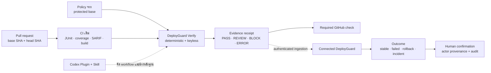

# DeployGuard AI

**พิสูจน์ว่าสิ่งใดถูกตรวจสอบก่อนปล่อย change และบันทึกสิ่งที่เกิดขึ้นหลัง deploy โดยไม่ต้องส่ง source code ให้ LLM**

[](https://github.com/kingggg5/deployguardai/actions/workflows/ci.yml)
[](https://github.com/kingggg5/deployguardai/actions/workflows/codeql.yml)
[](https://github.com/marketplace/actions/deployguard-verify)
[](LICENSE)

[English](README.md) · [Quickstart](docs/QUICKSTART.md) · [Architecture](docs/ARCHITECTURE.md) · [Roadmap](docs/ROADMAP.md)


DeployGuard AI เป็นแพลตฟอร์ม open source สำหรับตรวจความปลอดภัยของ change
และเก็บหลักฐานการทำงานของระบบ เหมาะกับทีม GitHub, Platform Engineering,
DevOps และ SRE ระบบนำผลจาก CI ที่มีอยู่แล้วมาสร้าง receipt แบบ canonical
ซึ่งผูกกับ base/head commit ที่แน่นอน จากนั้น connected mode สามารถเชื่อม
change เดียวกันกับ deployment, incident, rollback, stability window และคำตัดสินของมนุษย์ได้

การตรวจสอบไม่ต้องใช้ LLM API key ส่วน Plugin/Skill ช่วยจัดลำดับงานให้ agent
แต่ผลจาก deterministic receipt เท่านั้นที่มีสิทธิ์ตัดสิน

## ประโยชน์หลัก

| ปัญหาที่พบจริง | สิ่งที่ DeployGuard ทำ |
| --- | --- |
| CI เป็นสีเขียวแต่ไม่รู้ว่าตรวจอะไรไปแล้ว | receipt เก็บ evidence ID, hash, source SHA และผล policy ไว้ตรวจย้อนหลังได้ |
| หลักฐานหาย เก่า หรือมาจากคนละ commit | คืนค่า `REVIEW` แทนการเดาว่าผ่าน |
| Agent อธิบายได้มั่นใจเกินหลักฐาน | Skill ต้องอ้าง receipt และไม่สามารถสร้างหลักฐานหรือเปลี่ยนผลได้ |
| Change, deployment และ incident กระจายอยู่หลายระบบ | เชื่อมข้อมูลด้วย exact SHA พร้อม rollback, outcome และ human confirmation |
| ต้องการนำข้อมูล operations ไปสร้าง dataset | มี consent, redaction, immutable registry, revocation และ leakage checks |
| แต่ละ repo มีวิธี review ไม่เหมือนกัน | ใช้ Action, CLI, policy และ Skill contract เดียวกันข้ามทีมและภาษาได้ |

DeployGuard **ไม่** รันคำสั่งจาก repository เอง, merge PR, deploy, rollback,
แก้ infrastructure หรือใช้คำตอบของโมเดลเป็นหลักฐานการตรวจสอบ

## เลือกวิธีใช้งาน

| วิธี | เหมาะกับ | สิ่งที่ได้ |
| --- | --- | --- |
| **GitHub Action** | ทำ required check บน PR | ผล `PASS` / `REVIEW` / `BLOCK` / `ERROR` จากหลักฐาน CI จริง |
| **Codex Plugin + Skill** | ให้ agent ช่วย review change | workflow ที่ทำซ้ำได้ แยก unknown ชัด และอ้าง receipt ทุกครั้ง |
| **CLI** | ใช้ในเครื่องหรือ CI อื่น | verifier contract เดียวกันโดยไม่ผูกกับ GitHub |
| **Connected platform** | ทีม Platform/SRE | GitHub ingestion, deployment, telemetry, incident, evidence graph, verdict, RLS และหน้า Operations |

## ติดตั้ง GitHub Action

ติดตั้งแบบง่ายจาก Marketplace release `@2`:

```yaml
- name: DeployGuard Verify
  uses: kingggg5/deployguardai@2
  with:
    base-sha: ${{ github.event.pull_request.base.sha }}
    head-sha: ${{ github.event.pull_request.head.sha }}
    evidence-sha: ${{ github.event.pull_request.head.sha }}
    build-status: success
    junit: artifacts/junit.xml
    coverage: artifacts/coverage.xml
    sarif: artifacts/results.sarif
```

สำหรับ protected production branch ให้ pin ด้วย full commit SHA ที่ตรวจแล้ว:

```yaml
uses: kingggg5/deployguardai@4cf9957da315bd384326c772bdaecbecf15c725b
```

ให้รัน build, test, coverage และ security tools ก่อน step นี้ DeployGuard จะอ่าน
ผลลัพธ์เหล่านั้นและเขียน `.deployguard/artifacts/evidence-receipt.json`
โดยไม่รันคำสั่ง arbitrary จากโปรเจกต์

Release `@2` สร้าง receipt ใน workflow เท่านั้นและยังไม่ publish ไปยัง connected
DeployGuard อัตโนมัติ ดู publisher แบบ authenticated และขอบเขตของ release ใน
[Quickstart](docs/QUICKSTART.md)

| ผล | Exit | ความหมาย |
| --- | ---: | --- |
| `PASS` | `0` | หลักฐานครบ ตรง SHA และผ่าน policy |
| `REVIEW` | `2` | หลักฐานขาด เก่า SHA ไม่ตรง หรือยังต้องให้มนุษย์ตัดสิน |
| `BLOCK` | `3` | หลักฐานที่พบขัดกับกฎที่วัดได้ |
| `ERROR` | `4` | ตรวจสอบไม่สำเร็จและระบบ fail closed |

## ติดตั้ง Codex Plugin

เพิ่ม Git marketplace แล้ว restart Codex จากนั้นติดตั้ง **DeployGuard AI** ในหน้า Plugins:

```bash
codex plugin marketplace add kingggg5/deployguardai --ref main
```

ตัวอย่างคำสั่ง:

```text
ใช้ $deployguard-change-safety ตรวจ pull request นี้ อ้างอิง receipt
แยกสิ่งที่มีหลักฐานออกจาก unknown และบอกสิ่งที่ยังต้อง review ให้ชัดเจน
```

Skill ช่วยหา revision และ artifact ที่ได้รับอนุญาต เรียก CLI ด้วยรูปแบบเดียวกับ
CI สรุป decision/reason/evidence ID และส่งต่องานให้ reviewer ได้เร็วขึ้น
ถ้าหลักฐานหายหรือ SHA ไม่ตรง Skill ต้องรายงานตามจริง ไม่เติมช่องว่างด้วยข้อความที่ดูน่าเชื่อ

ข้อดีสำคัญคือไม่ต้องส่ง OpenAI, Anthropic หรือ model-provider API key ให้
DeployGuard ตัว agent ใช้บัญชีเดิมของ host ได้ แต่ model output ไม่มีสิทธิ์เปลี่ยน
`REVIEW` หรือ `BLOCK` เป็น `PASS`

Plugin เป็น interaction layer จึงติดตั้ง evidence engine แยกใน repo ที่ต้องการตรวจ:

```bash
git clone https://github.com/kingggg5/deployguardai.git
cd deployguardai
python -m pip install ./verify
deployguard init --github --agent codex
```

## การทำงาน



## เปิด Connected Platform

```bash
git clone https://github.com/kingggg5/deployguardai.git
cd deployguardai
cp .env.example .env
docker compose up --build
```

- Web: <http://127.0.0.1:4300>
- API และ OpenAPI: <http://127.0.0.1:8100/docs>
- Demo data แยกจาก connected mode และมีป้ายกำกับชัดเจน ดู [Quickstart](docs/QUICKSTART.md)

สถาปัตยกรรมใช้ ASP.NET Core 10/YARP เป็น public control plane, FastAPI และ
worker อยู่ภายใน, PostgreSQL 16 เป็น production source of truth พร้อม tenant
RLS, Angular เป็น web client และ Python ดูแล deterministic evidence/evaluation engines

## สถานะตามจริง

- **มีแล้ว:** keyless receipt, Action `@2`, authenticated receipt ingestion,
  evidence-backed GitHub Check, deployment outcome, OTLP-normalized intake,
  notification outbox, SLO summary, PostgreSQL RLS และ dataset release governance
- **ผู้ดูแลระบบต้องตั้งค่า:** GitHub App, attestation verification, OIDC,
  PostgreSQL non-owner role, OTLP Collector และ Slack/Teams/PagerDuty credentials
- **Dataset:** ตัวอย่าง public ใน repo ยังเป็น synthetic เท่านั้น ยังไม่เรียกว่า
  production benchmark จนกว่าจะมี consented real corpus, redaction review,
  adjudicated labels, frozen splits, contamination checks และ baseline evaluation
- **Plugin:** ยังเป็น pre-1.0 และมีหน้าที่ orchestrate หลักฐาน ไม่ทำ autonomous remediation

## เอกสารและชุมชน

[Quickstart](docs/QUICKSTART.md) · [Architecture](docs/ARCHITECTURE.md) ·
[Operations](docs/OPERATIONS.md) · [Security](docs/SECURITY.md) ·
[API contract](docs/API_CONTRACT.md) · [AI boundary](docs/AI_BOUNDARY.md) ·
[Dataset card](bench/README.md) · [Roadmap](docs/ROADMAP.md)

[Contributing](CONTRIBUTING.md) · [Code of Conduct](CODE_OF_CONDUCT.md) ·
[Governance](GOVERNANCE.md) · [Support](SUPPORT.md) ·
[Security reporting](.github/SECURITY.md) · [Changelog](CHANGELOG.md)

DeployGuard AI ใช้สัญญาอนุญาต [Apache-2.0](LICENSE)
